  

  

# Ayesha

**Cybersecurity · Python · Linux · Networking**

> Building and documenting security tools to understand how they really work.

I'm a cybersecurity learner focused on ethical hacking and network analysis. I build my own tools instead of only using existing ones, and I document what they do, how to run them, and where they fall short.

- **Current focus:** Networking, Linux, Python for security
- **Learning:** Wireshark, Kali Linux, web security basics
- **Approach:** define scope, reproduce behavior, validate findings, document everything

---

## Selected projects

| Project | Overview |
|---|---|
| [Packet Sniffer](https://github.com/Acci0chad/packet-sniffer) | Python and Scapy sniffer that shows source/destination IPs, protocols, ports, and DNS queries in real time. |

*Each project includes setup instructions, usage examples, and honest notes on limitations.*

---

## Technical focus

**Security**
- Network traffic analysis
- Packet inspection with Scapy and Wireshark
- Linux security basics
- Authorized testing in my own lab only

**Tools and languages**
- Python and Bash
- Kali Linux
- Git and GitHub

---

## Workflow

`01 / SCOPE` → `02 / REPRODUCE` → `03 / VALIDATE` → `04 / DOCUMENT` → `05 / IMPROVE`

---

## Connect

- GitHub: [@Acci0chad](https://github.com/Acci0chad)
- LinkedIn: [Ayesha S](https://www.linkedin.com/in/ayesha-s-6a9742434/)

---

Security testing is performed only in personal labs or on systems where explicit authorization has been granted.
